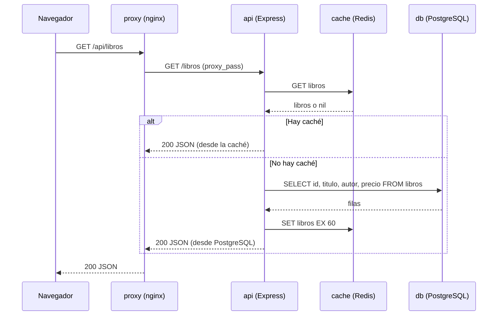
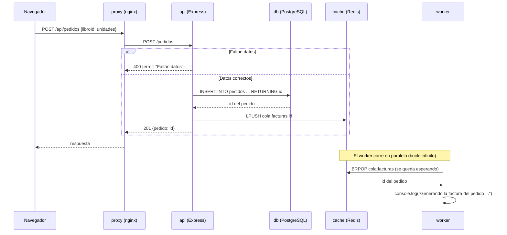

# Práctica 2 — Analizar una arquitectura con un agente

Análisis de la aplicación **tienda-libros** hecho con opencode, en modo Plan y con un agente de solo lectura (ejercicio 1). Todos los comandos se ejecutan dentro de la carpeta `tienda-libros/` y no ha hecho falta levantar la aplicación: todo se comprueba leyendo los ficheros. El registro de prompts está al final del documento y también en `prompts.md`.

## Ejercicio 1 — Agente en solo lectura (1p)

**Prompt (en modo Plan):** «Resume qué hace esta aplicación: qué servicios tiene y cómo se comunican.»

**Respuesta del agente:** resumen correcto de los cinco servicios (proxy, api, worker, db y cache), pero se inventó una carpeta `tests/` y un «frontend React» que no existen (ver ejercicio 7).

**`opencode.json` creado en el proyecto:**

```
$ cat opencode.json
{
  "$schema": "https://opencode.ai/config.json",
  "share": "disabled",
  "permissions": [
    { "action": "edit", "resource": "*", "effect": "deny" },
    { "action": "shell", "resource": "*", "effect": "ask" }
  ]
}
```

**Segundo prompt:** «Modifica docker-compose.yml y añade un servicio para exportar métricas.»

**Captura del rechazo:**

> ⛔ El intento de edición queda bloqueado por la configuración (`edit: deny` en `opencode.json`).
> `docker-compose.yml` no se ha modificado.

**Comprobación:**

```
$ grep -n "exporter" docker-compose.yml
(sin resultados: el fichero no se ha tocado)
```

**¿Por qué conviene un agente que no pueda escribir en la fase de análisis?**
Porque en esa fase solo queremos **entender** el sistema, no cambiarlo. Con `edit: deny` el repositorio queda intacto (es la fuente de verdad y el botón de deshacer) y el agente no puede «arreglar» cosas por su cuenta mientras investiga. `bash: ask` evita que ejecute órdenes sin revisarlas, y `share: disabled` impide compartir la sesión, que podría mostrar el `.env`.

## Ejercicio 2 — Inventario de componentes (1,5p)

**Prompt:** «Saca la lista de servicios del docker-compose con su imagen o construcción, puerto publicado, puerto interno, volúmenes, de qué depende cada uno y qué hace.»

**Comprobación (`cat -n` para poder citar líneas):**

```
$ cat -n docker-compose.yml
     1  services:
     2    proxy:
     3      image: nginx:1.27-alpine
     4      ports:
     5        - "8080:80"
     6      volumes:
     7        - ./nginx/default.conf:/etc/nginx/conf.d/default.conf:ro
     8        - ./web:/usr/share/nginx/html:ro
     9      depends_on:
    10        - api
    11      restart: unless-stopped
    12
    13    api:
    14      build: ./api
    15      environment:
    16        NODE_ENV: production
    17        PORT: 3000
    18        DATABASE_URL: postgres://tienda:${POSTGRES_PASSWORD}@db:5432/tienda
    19        REDIS_URL: redis://cache:6379
    20        JWT_SECRET: ${JWT_SECRET}
    21      depends_on:
    22        db:
    23          condition: service_healthy
    24        cache:
    25          condition: service_started
    26      restart: unless-stopped
    27
    28    worker:
    29      build: ./worker
    30      environment:
    31        REDIS_URL: redis://cache:6379
    32      depends_on:
    33        - cache
    34      restart: unless-stopped
    35
    36    db:
    37      image: postgres:16-alpine
    38      environment:
    39        POSTGRES_DB: tienda
    40        POSTGRES_USER: tienda
    41        POSTGRES_PASSWORD: ${POSTGRES_PASSWORD}
    42      volumes:
    43        - datos-db:/var/lib/postgresql/data
    44        - ./db/init.sql:/docker-entrypoint-initdb.d/init.sql:ro
    45      healthcheck:
    46        test: ["CMD-SHELL", "pg_isready -U tienda"]
    47        interval: 10s
    48        timeout: 5s
    49        retries: 5
    50      restart: unless-stopped
    51
    52    cache:
    53      image: redis:7-alpine
    54      command: ["redis-server", "--save", "60", "1"]
    55      volumes:
    56        - datos-cache:/data
    57      restart: unless-stopped
    58
    59    volumes:
    60      datos-db:
    61      datos-cache:

$ grep -n "ports:" docker-compose.yml
4:    ports:
$ grep -n "EXPOSE" api/Dockerfile
6:EXPOSE 3000
```

**Tabla (cada celda comprobada en los ficheros):**

| Servicio | Imagen o construcción | Puerto publicado | Puerto interno | Volúmenes | Depende de | Qué hace |
| --- | --- | --- | --- | --- | --- | --- |
| proxy | nginx:1.27-alpine | 8080 → 80 (líneas 4-5) | 80 (nginx/default.conf:2) | ./nginx/default.conf:ro y ./web (montado en /usr/share/nginx/html) | api | sirve la web estática y hace de proxy de `/api` hacia la api |
| api | build ./api (node:20-alpine) | — | 3000 (EXPOSE y PORT) | — | db (service_healthy) y cache | API REST de libros y pedidos; usa la caché y encola las facturas |
| worker | build ./worker (node:20-alpine) | — | — (no abre puerto; solo llama a Redis) | — | cache | saca pedidos de la cola y «genera» la factura (hoy solo la anota en el log) |
| db | postgres:16-alpine | — | 5432 (línea 18) | datos-db y ./db/init.sql:ro | — | base de datos de libros y pedidos |
| cache | redis:7-alpine | — | 6379 (líneas 19 y 31) | datos-cache | — | caché de libros (60 s) y cola `cola:facturas` |

**¿Cuántos servicios son accesibles desde fuera del equipo? Solo 1, el proxy.** Es el único que tiene `ports:` (líneas 4-5, `8080:80`); los demás no publican ningún puerto y solo se ven entre ellos en la red interna que crea Docker Compose, donde se localizan por el nombre del servicio (`db`, `cache`, `api`: líneas 18, 19, 31 y nginx/default.conf:13).

## Ejercicio 3 — Recursos de la aplicación (1,5p)

**Prompt:** «Clasifica todos los recursos del proyecto (contenido estático, código de servidor, datos y esquema, dependencias, configuración, secretos y registros), di en qué fichero o servicio vive cada uno y cuáles no deben subirse al repositorio. ¿Tiene .gitignore? Propón uno.»

**Comprobación:**

```
$ find . -type f | sort
./api/Dockerfile
./api/package.json
./api/src/server.js
./db/init.sql
./docker-compose.yml
./.env.example
./nginx/default.conf
./web/index.html
./worker/Dockerfile
./worker/package.json
./worker/worker.js

$ ls -a
.  ..  .env.example  api  db  docker-compose.yml  nginx  web  worker

$ cat .env.example
# Copia este fichero a .env y pon valores propios
POSTGRES_PASSWORD=cambiame
JWT_SECRET=cambiame-tambien
```

**Clasificación de los recursos:**

| Tipo de recurso | Dónde vive | ¿Al repositorio? |
| --- | --- | --- |
| Contenido estático | `web/index.html` (lo sirve el proxy desde `./web`, montado en solo lectura) | Sí |
| Código de servidor | `api/src/server.js` (Express) y `worker/worker.js`; sus Dockerfiles construyen las imágenes | Sí |
| Datos y esquema | Esquema y datos de ejemplo: `db/init.sql` (solo se ejecuta la primera vez). Datos reales: volúmenes `datos-db` (PostgreSQL) y `datos-cache` (Redis) | `init.sql` sí; los volúmenes no son ficheros del repo |
| Dependencias | `api/package.json` y `worker/package.json` (no hay `package-lock.json` ni `node_modules`) | Sí (`node_modules` no) |
| Configuración | `docker-compose.yml`, `nginx/default.conf` y `.env.example` | Sí |
| Secretos | Valores reales de `POSTGRES_PASSWORD` y `JWT_SECRET`, que van en el `.env` (que no está en el repo) | Solo la plantilla `.env.example`; el `.env` nunca |
| Registros | No hay ficheros de log: api y worker escriben por consola (stdout de los contenedores) | Nada que subir; se ignoran `*.log` por si acaso |

**¿Tiene `.gitignore`? No, no existe** (se ve en `ls -a`). **Propuesta**, creada como `.gitignore`:

```
$ cat .gitignore
# Secretos (no subir nunca)
.env

# Dependencias
node_modules/

# Registros
*.log

# Volcados de la base de datos
*.sql.gz
dump.sql
```

## Ejercicio 4 — Recorrido de una petición (1,5p)

**Prompt:** «Dibuja en Mermaid el recorrido de GET /api/libros incluyendo la caché, y el de POST /api/pedidos incluyendo la cola de facturas y el worker.»

**Respuesta del agente y correcciones:** el primer diagrama ponía la caché en nginx con un TTL de 5 minutos; el segundo era síncrono (la respuesta 201 llegaba después de generar la factura). Los corregí contra el código real.

**Comprobación:**

```
$ cat -n api/src/server.js
     1  const express = require('express');
     2  const { Pool } = require('pg');
     3  const { createClient } = require('redis');
     4
     5  const app = express();
     6  app.use(express.json());
     7
     8  const pool = new Pool({ connectionString: process.env.DATABASE_URL });
     9  const cache = createClient({ url: process.env.REDIS_URL });
    10  cache.connect().catch((e) => console.error('Redis no disponible', e));
    11
    12  app.get('/salud', (req, res) => res.json({ estado: 'ok' }));
    13
    14  app.get('/libros', async (req, res) => {
    15    const enCache = await cache.get('libros');
    16    if (enCache) return res.json(JSON.parse(enCache));
    17    const { rows } = await pool.query('SELECT id, titulo, autor, precio FROM libros ORDER BY id');
    18    await cache.set('libros', JSON.stringify(rows), { EX: 60 });
    19    res.json(rows);
    20  });
    21
    22  app.post('/pedidos', async (req, res) => {
    23    const { libroId, unidades } = req.body;
    24    if (!libroId || !unidades) return res.status(400).json({ error: 'Faltan datos' });
    25    const { rows } = await pool.query(
    26      'INSERT INTO pedidos (libro_id, unidades) VALUES ($1, $2) RETURNING id',
    27      [libroId, unidades]
    28    );
    29    await cache.lPush('cola:facturas', String(rows[0].id));
    30    res.status(201).json({ pedido: rows[0].id });
    31  });
    32
    33  app.listen(process.env.PORT || 3000, () => console.log('API escuchando'));

$ cat -n worker/worker.js
     1  const { createClient } = require('redis');
     2
     3  const cache = createClient({ url: process.env.REDIS_URL });
     4
     5  async function main() {
     6    await cache.connect();
     7    console.log('Worker de facturas en marcha');
     8    while (true) {
     9      const tarea = await cache.brPop('cola:facturas', 0);
    10      console.log('Generando la factura del pedido', tarea.element);
    11    }
    12  }
    13
    14  main();

$ grep -n "listen\|proxy_pass" nginx/default.conf
2:    listen 80;
13:        proxy_pass http://api:3000/;
```

(Ojo al detalle: la URL pública `/api/libros` la recibe nginx, y como el `proxy_pass` lleva barra final quita el prefijo `/api/`, así que a la api le llega `/libros`.)

**Diagrama 1 — GET /api/libros (con caché):**



**Diagrama 2 — POST /api/pedidos (cola de facturas y worker):**



**Verificación:** los dos diagramas pegados en VS Code (extensión «Markdown Preview Mermaid Support») se dibujan correctamente y coinciden con el código:

- la caché está en Redis con `EX: 60` (server.js:15-18), no en nginx;
- la api responde 201 justo después del `LPUSH` a `cola:facturas` (server.js:29-30), sin esperar al worker;
- el worker consume con `BRPOP` y de momento solo imprime por consola (worker.js:9-10): no hay factura persistida.

## Ejercicio 5 — Modelo de arquitectura (1,5p)

**Prompt:** «¿Qué modelo de arquitectura sigue esta aplicación y por qué?»

**Respuesta del agente:** «microservicios independientes, cada uno con su propia base de datos, que se comunican por REST y se orquestan con Kubernetes». **No se sostiene para esta aplicación.**

**Comprobación:**

```
$ grep -n "build:\|image:" docker-compose.yml
3:    image: nginx:1.27-alpine
14:    build: ./api
29:    build: ./worker
37:    image: postgres:16-alpine
53:    image: redis:7-alpine

$ grep -n "DATABASE_URL\|REDIS_URL" docker-compose.yml
18:      DATABASE_URL: postgres://tienda:${POSTGRES_PASSWORD}@db:5432/tienda
19:      REDIS_URL: redis://cache:6379
31:      REDIS_URL: redis://cache:6379

$ grep -n "lPush\|brPop" -r .
./api/src/server.js:29:  await cache.lPush('cola:facturas', String(rows[0].id));
./worker/worker.js:9:    const tarea = await cache.brPop('cola:facturas', 0);
```

**Análisis con evidencias:**

- **Despliegues independientes: uno solo.** Hay 5 servicios, pero se despliegan juntos con un único `docker compose up`: 2 se construyen (`api`, `worker`) y 3 son imágenes oficiales (nginx, postgres, redis). No hay repositorios, pipelines ni despliegues separados por servicio.
- **¿Quién habla con la base de datos? Solo la api.** `DATABASE_URL` aparece únicamente en sus variables (línea 18). El worker no tiene credenciales ni cliente de PostgreSQL: solo `REDIS_URL` (línea 31), y en su código solo se usa Redis.
- **¿Cómo se comunican?** Por la red interna de Docker Compose, por nombre de servicio (`db:5432`, `cache:6379`). El único HTTP entre servicios es proxy → api (nginx/default.conf:13); la api y el worker no hablan entre sí por REST, usan Redis como **cola de trabajos** (`LPUSH`/`BRPOP` sobre `cola:facturas`).

**El modelo real:** ni monolito clásico ni microservicios «de manual»: es una aplicación pequeña **desplegada como una sola unidad**, con piezas de responsabilidad separada (web, api, worker, datos, caché) que comparten una única base de datos y un único Redis (estilo monolito distribuido).

**La generalidad de manual que no se sostiene aquí:** «cada microservicio tiene su propia base de datos y se comunican por REST» — aquí hay **una sola BD compartida**, no hay API REST entre api y worker, y no hay Kubernetes en ninguna parte del proyecto.

**Ventajas para una tienda pequeña:** muy sencilla de entender y de desplegar (un comando, cinco contenedores); barata de alojar en una VM pequeña; ya trae caché y cola de trabajos sin servicios extra; responsabilidades bien separadas.
**Inconvenientes:** la BD y Redis son puntos únicos de fallo compartidos; no hay réplicas ni alta disponibilidad; escalar obliga a replicar contenedores que comparten la misma BD; los secretos van en variables de entorno simples; si Redis cae, se pierden a la vez la caché y la cola.

## Ejercicio 6 — Ficha de requerimientos de implantación (2p)

**Prompt:** «Redacta la ficha para poner la aplicación en producción (hardware o instancia, software y versiones, red, seguridad, entornos, datos y copias, monitorización, despliegue y vuelta atrás), distinguiendo lo que la aplicación ya trae de lo que hay que añadir.»

**Corrección:** el agente daba por hechas copias de seguridad y un healthcheck de la API que no existen; lo comprobé y moví esas cosas a «hay que añadir».

**Comprobación:**

```
$ grep -n "restart:\|healthcheck:\|volumes:" docker-compose.yml
6:    volumes:
11:    restart: unless-stopped
26:    restart: unless-stopped
34:    restart: unless-stopped
42:    volumes:
45:    healthcheck:
50:    restart: unless-stopped
55:    volumes:
57:    restart: unless-stopped
59:volumes:

$ grep -rn "backup\|pg_dump\|monitor" .
(sin resultados: no hay copias de seguridad ni monitorización)

$ grep -n "listen" nginx/default.conf
2:    listen 80;
```

**Ficha:**

| Área | Ya lo trae la aplicación | Hay que añadir para producción |
| --- | --- | --- |
| Hardware o instancia | Imágenes ligeras (alpine); no exige requisitos especiales | Una VM o VPS Linux (2 vCPU, 4 GB de RAM y 40 GB de disco sobran para los 5 contenedores) |
| Software y versiones | node:20-alpine (api y worker), nginx 1.27, postgres 16 y redis 7, definidos en los Dockerfiles y el compose | Docker Engine + plugin compose en el servidor, con versión fijada; política de actualización de las imágenes |
| Red, puertos y cortafuegos | nginx escucha en el 80 (publicado como 8080); comunicaciones internas resueltas (api:3000, db:5432, cache:6379) | Cortafuegos que abra solo 80/443 y cierre lo demás; dejar de publicar el 8080 al exterior; los puertos internos solo en la red de Docker |
| Dominio, DNS y TLS | Nada: solo HTTP y `server_name _` | Dominio propio, registros DNS y certificado (p. ej. Let's Encrypt) con redirección 80 → 443 en nginx |
| Seguridad y secretos | Secretos por variables de entorno y plantilla `.env.example`; BD y caché sin puertos publicados | Crear el `.env` real (fuera del repo, permisos 600) con contraseñas fuertes; rotación de secretos; usar de verdad el `JWT_SECRET` o quitarlo (hoy no se usa, ver ejercicio 7); contenedores con usuario no privilegiado; actualizaciones de seguridad |
| Entornos | `NODE_ENV=production` y un único compose | Separar producción y preproducción (variables y compose distintos) y probar cada cambio antes |
| Datos y copias de seguridad | Volúmenes `datos-db` y `datos-cache` (los datos sobreviven a los reinicios); `init.sql` crea el esquema y 3 libros de ejemplo solo la primera vez | Copia periódica de PostgreSQL (`pg_dump` programado + retención) y restaurar una copia de prueba; tener en cuenta que `init.sql` no vuelve a ejecutarse |
| Monitorización y registros | Ruta `/salud` en la API; healthcheck de la BD; logs de los contenedores por consola | Healthchecks de api, worker y cache; monitorización con avisos (p. ej. Uptime Kuma o Prometheus); centralizar y rotar los logs de Docker |
| Fases del despliegue | El `build` de las imágenes y el arranque con compose ya funcionan | Guion: VM y cortafuegos → instalar Docker → clonar el repo → crear `.env` → `docker compose up -d --build` → comprobar `/salud` y la web → activar TLS → copias y monitorización |
| Plan de vuelta atrás | El proyecto está en git y las imágenes se pueden volver a construir | Volver a la versión anterior (git checkout + `docker compose up -d` con la imagen previa) y restaurar el último volcado si el despliegue tocó datos; probar el rollback con antelación |

## Ejercicio 7 — Caza de afirmaciones falsas (1p)

**Comprobaciones:**

```
$ grep -rn "jwt\|JWT\|jsonwebtoken" .
./api/package.json:13:    "jsonwebtoken": "^9.0.2"
./.env.example:3:JWT_SECRET=cambiame-tambien
./docker-compose.yml:20:      JWT_SECRET: ${JWT_SECRET}

$ grep -n "pg\|Pool\|postgres" worker/worker.js
(sin resultados)

$ grep -n "ssl\|443" nginx/default.conf
(sin resultados)

$ find . -name "*test*"
(sin resultados)
```

**Afirmaciones falsas del agente y su desmentido:**

| Frase del agente | Fichero y línea que la desmiente | Lo correcto |
| --- | --- | --- |
| «El worker genera la factura y la guarda en PostgreSQL» | worker/worker.js:9-10 (solo `BRPOP` y un `console.log`; y docker-compose.yml:31, donde el worker solo recibe `REDIS_URL`) | Hoy no hay factura persistida: el worker solo anota en el log el pedido que saca de la cola |
| «La API protege los pedidos con JWT» | api/src/server.js:22-31 (POST /pedidos no comprueba ningún token; `jsonwebtoken` solo aparece en api/package.json:13 y el secreto en docker-compose.yml:20, sin usar) | Los endpoints son públicos: JWT está declarado pero no implementado |
| «El proxy sirve la tienda por HTTPS» | nginx/default.conf:2 (`listen 80`, sin `ssl` ni 443 en todo el fichero) | Solo HTTP; el certificado hay que añadirlo (ficha, ejercicio 6) |
| «El proyecto trae una carpeta tests/ con pruebas» | `find . -name "*test*"` no devuelve nada y `ls` no muestra tests/ | No hay ni una sola prueba en el proyecto |
| «PostgreSQL queda publicado al exterior en 5432» | docker-compose.yml:36-50 (el servicio db no tiene `ports:`; el único `ports:` está en el proxy, líneas 4-5) | La base de datos solo es accesible desde la red interna de Compose |

## Reto (ampliación)

Repetí el ejercicio 2 con dos prompts distintos:

| | Prompt vago | Prompt preciso |
| --- | --- | --- |
| Qué pedí | «explícame la arquitectura» | «con @docker-compose.yml y @api/src/server.js, hazme una tabla de los servicios con sus puertos y dependencias» |
| Qué respondió | Un texto largo y genérico: habló de microservicios y de Kubernetes, cosas que no están en el proyecto | La tabla exacta, citando líneas de los ficheros que le pasé |
| Conclusión | Al no darle ficheros ni formato, rellena con generalidades (y con errores) | Con contexto y formato fijado, la respuesta es comprobable y casi no hay que corregir |

## Registro de prompts

| Nº | Prompt (resumido) | Qué hizo el agente | Qué corregí yo |
| --- | --- | --- | --- |
| 1 | «Resume qué hace esta aplicación y qué ficheros la componen» (modo Plan, solo lectura) | Resumen correcto de los 5 servicios, pero se inventó una carpeta `tests/` y un «frontend React» | `find . -type f` y `ls -a`: no hay `tests/` ni React; `web/index.html` es HTML plano. Corregí el resumen |
| 2 | «Modifica docker-compose.yml para añadir un servicio de métricas» | No pudo: opencode bloqueó la edición (`edit: deny`, captura en el ejercicio 1) | Nada; era justo lo que se pedía comprobar |
| 3 | «Saca la tabla de inventario de servicios» (puertos, volúmenes, dependencias) | Tabla casi correcta, pero decía que el worker también escribe en PostgreSQL | `grep DATABASE_URL/REDIS_URL` en el compose: la BD solo la usa la api; el worker solo habla con Redis. Corregí esa fila |
| 4 | «Clasifica los recursos del proyecto y propón un .gitignore» | Clasificación correcta; proponía ignorar `web/` y `db/init.sql` | Corregí: el estático y el esquema van al repo; fuera solo `.env`, `node_modules`, logs y volcados. Creé el `.gitignore` |
| 5 | «Dibuja en Mermaid el recorrido de GET /api/libros con la caché» | Bien en general, pero ponía la caché en nginx y TTL de 5 minutos | `cat -n api/src/server.js`: la caché es Redis con `EX: 60` (líneas 15-18). Corregí el diagrama |
| 6 | «Dibuja el recorrido de POST /api/pedidos con la cola y el worker» | Lo pintó síncrono: decía que el 201 se devolvía después de generar la factura | server.js:29-30: la API encola y responde 201; el worker consume con `BRPOP` (worker.js:9). Corregí el orden |
| 7 | «¿Qué modelo de arquitectura sigue la aplicación y por qué?» | «Microservicios con una base de datos por servicio, comunicación REST y Kubernetes» | No hay Kubernetes, ni REST entre servicios, ni BD por servicio; evidencia: compose (5 servicios, 1 compose, 1 BD) y `LPUSH`/`BRPOP`. Reescribí con el contraste |
| 8 | «Redacta la ficha de implantación distinguiendo lo que ya trae de lo que falta» | Ficha completa, pero daba por hechas copias de seguridad y healthchecks de la API que no existen | `grep healthcheck/backup`: solo hay healthcheck en la BD y ninguna copia. Pasé esas filas a «hay que añadir» |
| 9 | (Reto) «explícame la arquitectura» frente a prompt preciso citando `@docker-compose.yml` y `@api/src/server.js` | El vago: respuesta genérica con cosas que no están (Kubernetes, microservicios); el preciso: ajustada al compose y al código | Me quedé con la respuesta del prompt preciso y anoté las diferencias (reto) |
